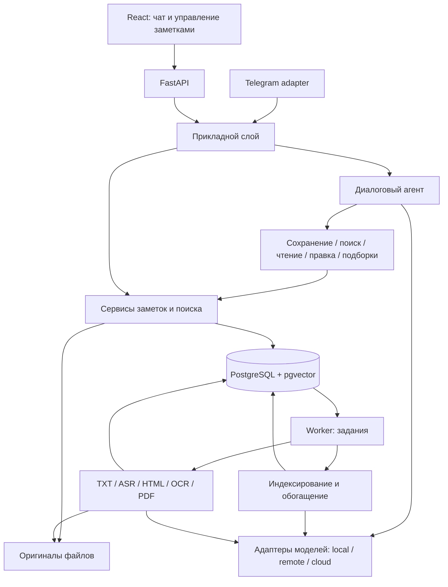

# Архитектура Local Note Agent

Дата актуализации: 2026-11-13. Целевая архитектура студенческого MVP.

В репозитории уже есть прототип импорта на SQLite/SQLAlchemy: текст, HTML,
изображения, WAV/MP3, оригиналы, фоновые задания и Docker. Он требует адаптации
под описанную ниже архитектуру. Наличие кода не означает выполнения приёмки.
Файловое хранилище, extractors, проверки входа, изоляцию процессов и полезные
тестовые сценарии следует переиспользовать. Совместимость с SQLite, ORM,
Alembic и API версий не требуется; эти части разрешено заменить.
Текущий код и его OpenAPI описывают прототип; целевые контракты задаёт этот документ.
Порядок работ и текущее состояние задач — в [плане работ](work-plan.md).

Содержание:

- [1. Требования и границы](#1-требования-и-границы)
- [2. Общая схема](#2-общая-схема)
- [3. Стек и границы модулей](#3-стек-и-границы-модулей)
- [4. Модель данных](#4-модель-данных)
- [5. Импорт и фоновые задания](#5-импорт-и-фоновые-задания)
- [6. Изменение и удаление заметок](#6-изменение-и-удаление-заметок)
- [7. Диалоговый агент](#7-диалоговый-агент)
- [8. Поиск, ответы и граф](#8-поиск-ответы-и-граф)
- [9. Форматы и обработка аудио](#9-форматы-и-обработка-аудио)
- [10. Подключение моделей](#10-подключение-моделей)
- [11. HTTP API](#11-http-api)
- [12. Контракт обработки знаний](#12-контракт-обработки-знаний)
- [13. Структура проекта](#13-структура-проекта)
- [14. Развёртывание и эксплуатация](#14-развёртывание-и-эксплуатация)
- [15. Этапы и проверка готовности](#15-этапы-и-проверка-готовности)

## 1. Требования и границы

Приложение собирает материалы через Telegram и веб-интерфейс в общую базу
знаний, автоматически извлекает текст, строит поисковый индекс, формирует
краткое содержание и теги. Диалоговый агент сохраняет и редактирует заметки,
ищет материалы и отвечает по сохранённым текстам. Веб-интерфейс отображает граф связей.

- Основной язык — русский; поддерживается английский.
- Расчётный объём — тысячи материалов.
- Доступ открыт: все участники читают, создают, изменяют и удаляют заметки.
- Каждый файл или самостоятельное сообщение образует отдельную заметку.
- Пакетная загрузка объединяет заметки в подборку; одна заметка может входить
  в несколько подборок.
- Текстовые файлы, аудио, PDF, изображения и ссылки обрабатываются адаптерами
  форматов. Перечень форматов и ограничения приведены в разделе 9.
- Локальный запуск и серверное развёртывание используют одну кодовую базу.
- Генерация, embeddings и распознавание речи имеют независимые настройки.
  Модели работают локально, на GPU-сервере или через облачный API.

MVP включает Telegram и веб, текст/пересылки, TXT/Markdown, пачки файлов,
голос и аудио, поиск, ответы, обогащение, правку через диалог и автоматический граф.
PDF, OCR изображений и HTML-ссылки — дополнительные адаптеры после основного
сценария; уже реализованный код сохраняется и адаптируется по соответствующим задачам.

Цитаты, список источников ответа, ссылки на исходные фрагменты, выделение
утверждений, сегменты и таймкоды аудио не входят в MVP. Разбиение длинного
текста на внутренние chunks для поиска не является пользовательской разметкой.
Напоминания, автоматическая синхронизация и история редакций также не входят в MVP.

## 2. Общая схема

Модульный Python backend, несколько процессов из одной кодовой базы.
Веб, Telegram и диалоговый агент используют общий прикладной слой;
правила заметок не дублируются в обработчиках транспорта.



API быстро возвращает результат сохранения; длительные операции выполняет
worker. Очередь jobs хранится в PostgreSQL и переживает перезапуск.
Telegram-процесс вызывает общий Python-слой напрямую. Обычный CRUD
доступен без моделей.

## 3. Стек и границы модулей

| Компонент | Технология и ответственность |
|---|---|
| HTTP API | FastAPI, Pydantic, Uvicorn: валидация запросов и маршруты |
| SQL | PostgreSQL: заметки, задания, метаданные, подборки, диалоги и связи |
| Векторный поиск | pgvector: embeddings фрагментов и поиск по расстоянию |
| Доступ к БД | Psycopg 3, пул соединений, pgvector-python; явный SQL и SQL-миграции |
| Telegram | aiogram: получение сообщений и файлов, отправка ответов |
| Фоновые задания | Таблица `jobs` в PostgreSQL и отдельный worker |
| Файлы | Каталог оригиналов с серверными ключами хранения |
| Генерация | HTTP-клиент OpenAI-compatible API |
| Аудио | whisper.cpp на macOS; faster-whisper на сервере через ASR-адаптер |
| Веб-страницы | urllib3 для загрузки с привязкой к проверенному IP, Trafilatura для извлечения содержимого |
| Документы и OCR | Docling для PDF, Tesseract `rus+eng` для изображений |
| Веб-интерфейс | React + TypeScript: заметки, загрузки, чат, поиск и граф |
| Граф | Таблица `note_links`, визуализация Cytoscape.js |

CRUD, поиск и управление заданиями используют явный параметризованный SQL
через Psycopg 3. SQL-запросы находятся в слое доступа к данным, отдельно от
HTTP-обработчиков; Pydantic описывает входы и выходы API.
Соединения берутся из пула, границы транзакций задаются прикладными сервисами.
План поиска проверяется
через EXPLAIN ANALYZE. Метаданные, фрагменты и векторы находятся в одной БД,
поэтому изменение текста, очистка индекса и постановка заданий выполняются
одной транзакцией.

Модели отделены от приложения HTTP-контрактами. Загрузка весов, квантизация
и использование GPU относятся к серверу моделей. Версии библиотек и образов
фиксируются в lock-файлах и конфигурации сборки.
[Интеграция pgvector с Psycopg 3](https://github.com/pgvector/pgvector-python#psycopg-3).

Схема создаётся последовательными SQL-миграциями `001_initial.sql`,
`002_*.sql`. Команда `make migrate` применяет их по порядку и записывает
номер и checksum в `schema_migrations`; применённые файлы не изменяются.
Запуск миграций защищён PostgreSQL advisory lock. Каждая миграция выполняется
транзакционно; в первой версии используются только совместимые с этим DDL.
Изменения схемы оформляются новой миграцией, без автоматической генерации из моделей.

## 4. Модель данных

Каждый самостоятельный файл или сообщение создаёт отдельную заметку;
пачка объединяется в import batch. Пользовательская подборка — отдельная сущность:
она живёт независимо от технической загрузки и может объединять разные импорты.

Идентификаторы — UUID в строковом виде. Даты — UTC, в API формат ISO 8601.
Массивы и небольшие метаданные храним в JSONB-колонках PostgreSQL.

### `notes` — заметка, которую видит пользователь

| Поле | Назначение |
|---|---|
| `id` | Идентификатор |
| `title` | Заголовок |
| `extracted_text` | Текущий текст для чтения, поиска и LLM; допускает ручную правку |
| `ingestion_status` | `queued`, `processing`, `ready`, `failed` |
| `processing_status` | `not_requested`, `queued`, `processing`, `ready`, `failed`: общая обработка знаний |
| `summary`, `category` | Результаты обогащения, первоначально `null` |
| `tags`, `entities` | Результаты обогащения, первоначально пустые массивы |
| `ingestion_error`, `processing_error` | `null` или объект с безопасными `code` и `message` |
| `created_at`, `updated_at` | Время создания и изменения |
| `deleted_at` | `null` у действующей заметки; отметка удаления |

### `sources` — исходный материал

| Поле | Назначение |
|---|---|
| `id`, `note_id` | Идентификатор и связь с заметкой |
| `type` | `text`, `text_file`, `url`, `image`, `audio`, `pdf` |
| `original_text` | Исходный текст только для `text` |
| `original_url` | Введённая ссылка только для `url` |
| `metadata` | Например, конечный URL, заголовок страницы, язык, длительность |
| `created_at` | Время добавления |

Канал (`web`/`telegram`) и внешние ID хранятся отдельно от формата материала.
`note_id` уникален: у заметки ровно один источник.
Оригинал сохраняется при ручной правке `extracted_text`.
Замена исходного файла и повторное скачивание страницы не входят в API.

### `attachments` — оригиналы на диске

Поля: `id`, `source_id`, `original_name`, `storage_key`, `mime_type`,
`size_bytes`, `created_at`.

Текстовые файлы, PDF, изображения и аудио сохраняются как оригинальные файлы. Для ссылки сохраняем
полученный HTML как вложение источника. Для введённого текста файл не нужен.
`storage_key` — относительный служебный путь, например
`uploads/<attachment_id>/original.jpg`. В API его не возвращаем.
Пользовательское имя файла используется только как метаданные.

Происхождение Telegram: `sources.channel`, `delivery_scope` (идентичность бота),
`delivery_id` (ID доставки/update), `telegram_chat_id`, `telegram_message_id`.
Оригинальный `forward_origin` и прочие метаданные пересылки сохраняются в
`metadata`; они не подменяются ID доставки. Уникальность
`(channel, delivery_scope, delivery_id)` предотвращает повторное создание заметки.
Прикладной `NotesService.create(TextNoteCreate, delivery=TelegramDelivery | None)`
принимает внутренний контекст доставки, не меняя HTTP DTO. `bot_id` (числовой ID,
не username и не token) хранится строкой в `delivery_scope`, update ID — строкой
в `delivery_id`. Конфликт уникального ключа откатывает создание проигравшей
заметки через savepoint и возвращает существующую карточку без нового process.
Повтор после удаления возвращает ошибку «заметка не найдена», не восстанавливает её.
Ответ транспорта разрешён только после выхода сервиса из транзакции.

Новая отправка получает другой delivery ID даже для того же файла. У batch
внешний ID — media group ID в области бота и чата; item хранит delivery ID.
Сообщения диалога имеют уникальный delivery ID внутри conversation.
Для Telegram conversation внешний ID — chat ID в области бота.

`notes.title_is_explicit` защищает заданный пользователем заголовок;
`manual_tags` отделены от автоматических `tags`.
Имена полей порядка: `chunks.position` и `import_items.position` (с нуля).
FK `(job_id, note_id)` у chunks/enrichments запрещает результат чужой заметки.
Проверку актуальной lease/token при публикации выполняет прикладной слой T06/T08
под блокировкой заметки; наличие колонок само по себе эту проверку не заменяет.

`embedding_profiles` содержит единственный профиль пространства векторов:
модель P02 `qwen3-embedding:0.6b`, digest из manifest P02, 1024, cosine,
L2 и полный query instruction. Chunks ссылаются на него, столбец — `vector(1024)`;
несовместимая размерность вызывает ошибку. Обновление профиля при наличии chunks
запрещено; прикладной слой должен сверять идентичность результата с профилем
под блокировкой профиля перед публикацией. Перед сменой профиля индекс очищается.
Граф хранит неориентированные пары в каноническом порядке UUID
`source_note_id < target_note_id`, score в диапазоне [-1, 1].

### Дополнительные сущности

| Таблица | Данные |
|---|---|
| `import_batches` | Канал, внешний ID, прогресс и счётчики результатов загрузки |
| `import_items` | Один вход, исходное имя/путь, результат или ошибка, полученный note ID |
| `collections`, `collection_notes` | Подборки и связи с заметками; заметка может входить в несколько подборок |
| `chunks` | note ID, job ID, порядок, текст, embedding и его модель; только внутренний поисковый индекс |
| `enrichments` | Модель и версия prompt для summary, автоматических тегов и сущностей |
| `note_links` | Заметки, тип связи, оценка и источник расчёта; связи автоматически вычисляются по embeddings |
| `conversations`, `messages` | Контекст диалога, обычные ответы и результаты инструментов |

Канал доставки и формат материала — разные свойства. Ручные и автоматически
назначенные теги хранятся отдельно. Правки текста не стирают ручную организацию.

## 5. Импорт и фоновые задания

### Последовательность обработки

1. **Сохранение:** принять материал, сохранить оригинал, создать заметку и job.
   Текст и исходные метаданные доступны без генеративной модели.
2. **Извлечение:** прочитать TXT/Markdown или распознать аудио в обычный текст.
   Для введённого текста этот шаг уже выполнен при сохранении.
3. **Обработка знаний:** один обработчик последовательно строит индекс,
   затем формирует summary, теги, категорию и сущности. Это один `process` job,
   без отдельных очередей и статусов индексирования и обогащения.

Текст создаётся с `ingestion_status=ready`; файл — с `queued` и `extract` job.
После извлечения сохраняется `extracted_text`, ставится `ready` и создаётся
`process` job. Если обработка знаний выключена, `processing_status=not_requested`.
Для текста заголовок берётся из первой строки, для файла — из имени, если
он не передан. Автоматическое обогащение может уточнить временный заголовок;
явно заданный заголовок без запроса не перезаписывается.

`ingestion_status`: `queued`, `processing`, `ready`, `failed`.
`processing_status`: `not_requested`, `queued`, `processing`, `ready`, `failed`.
Ошибка сохраняется в соответствующем поле и показывается в карточке.
Сохранённый текст не исчезает из-за ошибки модели. Если индекс уже записан,
а генерация summary завершилась ошибкой, индекс остаётся доступным. Повтор
`process` заново выполняет ту же последовательность; отдельный механизм
восстановления каждой внутренней стадии не нужен.

### Jobs и один worker

В PostgreSQL хранятся `id`, `note_id`, `kind`, `status`, `attempts`, `error`,
`created_at`, `started_at`, `finished_at`, `lease_until`, `lease_token`.
Виды: `extract`, `process`, `cleanup`. Статусы: `queued`, `processing`, `done`,
`failed`, `cancelled`. Частичный уникальный индекс `(note_id, kind)` запрещает
несколько активных jobs одного вида. Индекс очереди — `(status, created_at)`.

В MVP работает один worker; тяжёлые задания выполняются последовательно.
Redis, Celery, несколько очередей и распределённый планировщик не нужны.
Создание заметки и job — одна транзакция. Для занятия job используется короткая
транзакция с `FOR UPDATE SKIP LOCKED`, новой lease и token. Worker продлевает
lease; после истечения job можно занять заново. Результат сохраняется только
при актуальном token и статусе `processing`.

Lease защищает от устаревшего результата, а не задаёт требование нескольких
worker. Изоляцию тяжёлого задания в процессе и конечный таймаут можно сохранить
из прототипа. Ошибка помечает job как `failed`; повтор — явный запрос через API.
Автоматические повторы с backoff и специальные сценарии падения БД не требуются.

Перед каждой записью результата worker блокирует заметку и проверяет, что она
не удалена, job активен и token совпадает. PATCH использует ту же блокировку.
Lease должна оставаться действующей; истёкшее занятие не публикует результат.
Если операция блокирует и заметку, и job, порядок един: заметка, затем job.
Одношаговый extract публикует текст, ingestion ready, постановку process
(если включена обработка) и завершение extract одной транзакцией через
`JobsRepository.publish(..., complete=True)`; production binding задаёт
`complete_on_publish=True`. Process сохраняет промежуточную публикацию индекса
до обогащения. Длительные вычисления и запросы к моделям выполняются вне транзакций.
Повтор обработки заменяет производные данные, не накапливает их дубликаты.

Telegram delivery ID используется для защиты от повторной доставки. Новая
самостоятельная отправка того же файла создаёт отдельный материал. Пачка файлов
имеет отдельный результат на файл; ошибка одного не отменяет остальные.

## 6. Изменение и удаление заметок

Изменение через `PATCH /api/v1/notes/{id}`:

```json
{
  "title": "Обновлённый конспект",
  "extracted_text": "Исправленный текст заметки."
}
```

Нужно хотя бы одно изменяемое поле; `null` и пустые значения отклоняются.
Редактирование доступно для заметки с готовым извлечением.
При изменении в одной транзакции блокировать строку заметки, сохранить новый
текст, отменить её активные задания и удалить старые chunks/embeddings и
автоматические связи. Очистить summary, автоматические теги, категорию,
сущности и ошибки; создать один новый `process` job.
Заметка сразу исчезает из смыслового индекса до завершения новой обработки.
ID, исходный материал, ручные теги и подборки сохраняются.
Заметка остаётся доступной в списке и для чтения; статус показывает обработку.
При выключенном модуле job не создаётся, `processing_status=not_requested`.

Это пересоздание производных данных, а не физическое удаление заметки.
История редакций, счётчики версий и откат не предусмотрены.
Конкурентные правки применяются в порядке записи: последняя сохранённая правка
определяет текст. Агент использует тот же PATCH без обязательного подтверждения.
При неоднозначном выборе заметки требуется уточнение.

При изменении только подборок или ручных тегов пересоздание индекса не требуется.
После записи нового текста новые поисковые запросы не возвращают прежние chunks.
Перегенерация уже показанных ответов и история источников не предусмотрены.

### Удаление

При DELETE API ставит `deleted_at`, отменяет активные jobs и создаёт
`cleanup`. Заметка сразу исчезает из API, поиска и графа.
Очистка удаляет фрагменты, рёбра и оригиналы; ошибка сохраняется в jobs.
Повтор DELETE может повторно поставить неудавшуюся очистку.
Служебная запись остаётся до успешной очистки.

## 7. Диалоговый агент

### Единый диалог

В Telegram и веб-чате действует единый диалог без обязательных `/ask` и `/search`.
Модель выбирает действие по запросу: сохранение, поиск, ответ по базе,
правка или работа с подборкой. Поиск возвращает найденные заметки;
ответ использует найденные тексты как контекст для генерации.
Разделение поиска и ответа существует внутри backend и не требует команд.
Файлы и пересланные материалы по умолчанию импортируются; сопровождающее
указание может задавать способ обработки. Голос сначала расшифровывается,
затем проходит тот же выбор действия. При неясном намерении — уточнение.
Пересылки и пачки не должны требовать заранее вводить заголовок: исходное имя,
первая строка или временный заголовок используются до автоматического обогащения.

### Инструменты

Агенту доступны `save_note`, `search_notes`, `get_note`, `update_note` и
операции подборок. Сервер проверяет аргументы и исполняет ограниченное число
вызовов. Основной режим — native tool calling: модель возвращает имя инструмента
и аргументы, backend валидирует их, выполняет операцию и передаёт результат
модели. Для endpoint без его поддержки совместимый профиль может использовать
JSON-действие с той же валидацией и тем же прикладным слоем.
Генерация ответа и вызов инструмента — отдельные результаты;
успех сохранения/изменения подтверждается только после успешного выполнения.

Материалы базы являются данными, а не инструкциями на вызов инструментов.
Запрос на правку применяется к одной определённой заметке; при неоднозначности
агент уточняет объект. Отдельное подтверждение или экран согласования не нужны.
Массовые изменения и автоматическое удаление по свободному запросу не входят в состав приложения.

## 8. Поиск, ответы и граф

Индексируется нормализованный текст заметки, не только summary. Короткие
заметки целиком, длинные — внутренними chunks примерно по 600 токенов
с перекрытием 80; параметры задаются конфигурацией. У chunks есть note ID,
порядок и текст. Координаты страниц, диапазоны оригинала и пользовательские
идентификаторы цитат не хранятся для MVP.

Поиск: фильтры → полнотекстовый RU/EN и dense retrieval → RRF → устранение
повторов → заметки с кратким текстовым превью. Это выдача найденных заметок,
а не система цитирования ответа. Точные термины и перефразированные запросы
проверяются на небольшом заранее заданном корпусе.

RAG: выбрать релевантные тексты в пределах контекста → передать модели →
показать обычный текстовый ответ. При нехватке данных ответ должен сообщать
об этом. История диалога ограничена; follow-up учитывает её контекст.
Цитаты, список источников ответа, привязка утверждений, hover/click-подсветка,
ссылки на страницы и временные интервалы отложены за пределы MVP.

Граф строится автоматически по embeddings: top-k похожих заметок и порог
близости. Связи пересчитываются после обработки, удаляются при правке/удалении.
Пользователь не размечает рёбра. Cytoscape.js показывает ограниченное окружение
узла и переход к карточке заметки. Ребро означает семантическую близость;
анализ типизированных связей генеративной моделью и ручной редактор не требуются.

## 9. Форматы и обработка аудио

| Формат | Объём | Обработка |
|---|---|---|
| Текст / пересылка | MVP | Текст и метаданные происхождения |
| TXT, Markdown | MVP | Декодирование с сохранением абзацев и заголовков |
| Голос Telegram: OGG/Opus | MVP | Декодирование и единый текст транскрипта |
| WAV, MP3 | MVP | То же распознавание аудио |
| PDF | Дополнительный адаптер | Извлечение обычного текста, OCR сканов при необходимости |
| JPEG, PNG | Дополнительный адаптер | OCR русского и английского печатного текста |
| HTTP(S)-ссылка | Дополнительный адаптер | Сохранение HTML и извлечение текста Trafilatura |

Расширение и MIME не являются доказательством формата: контейнер и кодек
проверяются декодером. Собственный список форматов из прототипа расширяется
как минимум до OGG/Opus, WAV и MP3. Реальное голосовое Telegram проверяется
в P03/T15; одним тестовым WAV поддержка голоса не подтверждается.
Исходник сохраняется. ASR получает декодированное аудио напрямую либо временный
PCM/WAV, если этого требует runtime; конвертация с потерями в MP3 не нужна.
Техническое разбиение записи допускается внутри ASR; приложению возвращается
только полный текст. Сегменты, таймкоды и ссылки на время в MVP не сохраняются.

Настраиваемые лимиты по умолчанию: аудио 50 MiB/30 минут, текстовый файл 1 MiB,
извлечённый текст 100000 символов, заголовок 200 символов. Для дополнительных
адаптеров: изображение 10 MiB/25 млн пикселей, PDF 50 MiB, HTML 5 MiB.
Неподдерживаемый формат, пустой текст и превышение лимита дают явную ошибку.
Текст не обрезается молча. Транспорт Telegram может иметь более строгие лимиты
скачивания; его ошибка показывается отдельно от лимитов приложения.

ASR — отдельный адаптер. На Mac проверяется нативный запуск; faster-whisper CPU
из прототипа остаётся допустимым серверным профилем. Выбор модели и runtime
подтверждается P03. На старте одновременно распознаётся одна запись.
Для сравнения достаточно записей 2–5 минут; расширенные замеры по необходимости.

## 10. Подключение моделей

Граница приложения — HTTP endpoint, а не GPU. Выбор видеокарт, загрузка весов
и квантизация принадлежат model server. Приложение не импортирует CUDA runtime
для генерации и одинаково работает на Mac и обычном CPU-сервере с удалённой LLM.

Три независимых контракта:

- `TextGenerator`: chat, структурированное обогащение; streaming опционален.
- `Embedder`: пакет текстов → векторы с фиксированной идентичностью модели.
- `Transcriber`: аудио → полный текст и язык; без сегментов и таймкодов.

Конфигурация генерации: `LLM_BASE_URL`, `LLM_MODEL`, `LLM_API_KEY`,
timeout, лимит контекста/ответа, параллельность, provider-specific options.
Отдельные `EMBEDDING_*` и `ASR_*` настройки. API keys — серверные секреты.
Профили: `local` (host runtime), `remote-gpu` (тестовый GPU endpoint),
`cloud` (выбранный провайдер). URL внутри контейнера не равен localhost хоста.

Общий знаменатель — `/v1/chat/completions`. Поддержку streaming, JSON mode, JSON Schema,
tool calls и reasoning options фиксировать как capabilities конкретного endpoint.
Даже совместимые серверы поддерживают разное подмножество API.
Основной профиль генерации выбирается с native tool calling для инструментов
и JSON mode для структурированного обогащения. Оба режима проверяются в P01
плана работ до реализации модельного клиента. Они используются в отдельных
запросах согласно задаче; одновременная поддержка в одном запросе не требуется.
JSON mode обеспечивает синтаксический формат JSON, но не соответствие схеме
полей и не достоверность значений. Принудительная JSON Schema — отдельная
дополнительная возможность; при её отсутствии схему проверяет backend.
Streaming опционален: без него ответ возвращается целиком.
Для совместимого профиля без основных режимов допускается JSON по инструкции
с проверкой backend; такой профиль включается явно и отдельно проверяется.
Для действий и summary/тегов результат всегда валидируется через Pydantic;
невалидный ответ допускает ограниченный повтор, затем явную ошибку.
Ошибка формата не приводит к выполнению действия. Корректность значений
проверяется отдельно от корректности JSON.

[Ollama compatibility](https://docs.ollama.com/api/openai-compatibility),
[llama.cpp server](https://github.com/ggml-org/llama.cpp/blob/master/tools/server/README.md),
[vLLM serving](https://docs.vllm.ai/en/latest/serving/online_serving/).

Смена генеративной модели не требует переиндексации: сохраняем модель и prompt
в метаданных новых результатов; старые summary обновляются по явному запросу.
Смена embedding-модели требует очистки и перестроения индекса; до завершения
семантический поиск временно недоступен. Одновременное обслуживание двух
пространств векторов и переключение без простоя в MVP не нужны.
Смена ASR сохраняет контракт API заметок. Новая расшифровка обновляет текст,
очищает старый индекс и запускает повторную обработку.

### Модельные профили

| Назначение | Конфигурация |
|---|---|
| Генерация локально | Нативный OpenAI-compatible сервер на macOS |
| Генерация на тестовом GPU | OpenAI-compatible endpoint с проверенными tools/JSON mode; конкретная модель задаётся профилем |
| Генерация в облаке | OpenAI-compatible URL, ключ и имя модели провайдера |
| Embeddings | Конкретная модель проверяется в P02; фиксируются размерность, нормализация и query instruction |
| ASR на Mac | Нативный runtime и модель, проверенные в P03 |
| ASR на сервере | faster-whisper, CPU или CUDA согласно конфигурации хоста |

Для воспроизводимости профиль фиксирует артефакт модели, ревизию,
квантизацию и параметры контекста. Конкретные локальные артефакты выбираются
по результатам E0, а не считаются проверенными заранее.

Локальная среда — Apple Silicon M4 Pro, 48 GB общей памяти. Генеративный
сервер и ускоренный ASR запускаются нативно; контейнеры обращаются к ним
через `host.docker.internal`. Нативный ASR доступен через локальный сервис.
Рабочие процессы приложения не запускают бинарные файлы хоста из контейнера.
Общая память распределяется между macOS, моделями и контейнерами; измеряются
пиковая память, memory pressure и swap.

[whisper.cpp](https://github.com/ggml-org/whisper.cpp),
[faster-whisper](https://github.com/SYSTRAN/faster-whisper).

## 11. HTTP API

Префикс: `/api/v1`. JSON — для данных, `multipart/form-data` — для файлов.

| Метод и путь | Назначение | Успех |
|---|---|---|
| `POST /notes` | Создать текст; ссылка — при подключённом дополнительном адаптере | `201` для текста, `202` для ссылки |
| `POST /notes/import` | Создать заметку из одного файла | `202` |
| `POST /imports` | Принять пачку файлов в общий импорт | `202` |
| `GET /imports/{id}` | Прогресс и результаты по файлам | `200` |
| `GET /notes` | Список с пагинацией и фильтрами | `200` |
| `GET /notes/{id}` | Полная заметка и состояния обработки | `200` |
| `PATCH /notes/{id}` | Изменить заголовок и/или текущий текст | `200` |
| `DELETE /notes/{id}` | Скрыть заметку и поставить очистку в очередь | `204` |
| `POST /notes/{id}/retry` | Повторить неудачную обработку выбранной стадии | `202` |
| `GET /attachments/{id}/download` | Скачать сохранённый оригинал | `200` |
| `POST /search` | Поиск заметок с фильтрами и текстовым превью | `200` |
| `POST /chat/messages` | Сообщение агенту, текстовый ответ и результаты операций | `200` |
| `GET /graph` | Ограниченный подграф семантически близких заметок | `200` |
| `GET /health` | Проверить доступность API | `200` |

`/notes/import` регистрируется перед маршрутом `/notes/{id}`.
Интерактивная документация API: стандартная страница FastAPI `/docs`.

### Создание текста

`POST /api/v1/notes`

```json
{
  "source_type": "text",
  "title": "Конспект лекции",
  "text": "Симметричное шифрование использует общий секретный ключ."
}
```

### Создание из ссылки

`POST /api/v1/notes`

```json
{
  "source_type": "url",
  "title": "Статья о шифровании",
  "url": "https://example.com/article"
}
```

Поле `title` необязательно: первая строка текста или временный заголовок ссылки.
Модели запросов — размеченное объединение по `source_type`: у `text`
обязательно поле `text`, у `url` — `url`. Посторонние поля отклоняются.

### Создание из файла

`POST /api/v1/notes/import`, поля формы:

- `title`: необязательный заголовок; иначе используется имя файла;
- `source_type`: `text_file`, `audio`, `image` или `pdf`;
- `file`: один файл.

Тип файла должен соответствовать `source_type`.
Форматы: TXT/Markdown, WAV/MP3, OGG/Opus, JPEG/PNG и PDF.
Лимиты определены в разделе «Форматы и обработка аудио».
Превышение длительности аудио, обнаруженное worker, даёт ошибку обработки.

### Ответ с полной заметкой

И создание, и получение одной заметки используют одну схему `NoteDetail`:

```json
{
  "id": "9fa42325-266c-49a5-a600-bcbda41bbd47",
  "title": "Конспект лекции",
  "source": {
    "type": "text",
    "original_text": "Симметричное шифрование использует общий секретный ключ.",
    "original_url": null,
    "metadata": {}
  },
  "extracted_text": "Симметричное шифрование использует общий секретный ключ.",
  "ingestion_status": "ready",
  "processing_status": "not_requested",
  "summary": null,
  "tags": [],
  "category": null,
  "entities": [],
  "attachments": [],
  "ingestion_error": null,
  "processing_error": null,
  "created_at": "2026-10-22T19:30:00Z",
  "updated_at": "2026-10-22T19:30:00Z"
}
```

До извлечения `extracted_text=null`. Вложение в ответе содержит `id`,
`original_name`, `mime_type`, `size_bytes`, `download_url`.
Удалённые заметки и их вложения отвечают `404`.

### Список

`GET /api/v1/notes?limit=20&offset=0&source_type=audio&ingestion_status=ready`

Ответ: `{"items": [...], "total": 42, "limit": 20, "offset": 0}`.
`limit` от 1 до 100, `offset` неотрицательный. Фильтры необязательны.
Порядок: `created_at DESC, id DESC`.
В элементах списка достаточно `id`, `title`, `source_type`, статусов обработки,
`summary`, `tags`, `created_at`, `updated_at`. Полные тексты и оригиналы
в список не включаем. `total` учитывает фильтры и исключает удалённые записи.

### Редактирование

`PATCH /notes/{id}` применяет правила раздела «Изменение и удаление заметок».
Тело запроса содержит `title` и/или `extracted_text`; счётчика версий нет.

### Повтор и ошибки

`POST /notes/{id}/retry`: `{"stage": "extract"}` или `{"stage": "process"}`.
Повтор допускается после ошибки, оригинал используется заново.
`DELETE` сразу скрывает заметку; повтор до завершения cleanup безопасен.
Ошибки имеют вид `{"error": {"code": "invalid_file", "message": "Не удалось прочитать файл."}}`.
Ошибка фонового задания видна в карточке: GET возвращает `200`, а не `500`.
Клиент опрашивает состояния примерно раз в 2 секунды, пока идёт обработка.

### Пачки, подборки, поиск, чат и граф

- `POST /imports`: multipart с файлами, необязательными `collection_id` или
  `collection_title` (взаимоисключающие); ответ — batch ID, collection ID и item IDs.
  Заметки автоматически входят в существующую или новую подборку. Если ничего
  не передано, создаётся подборка с заголовком по дате импорта.
  В Telegram media group — один batch с автоматически созданной подборкой.
- `GET /imports/{id}`: прогресс, ошибки отдельных файлов и полученные note IDs.
- `POST /collections`: `{"title": "Лекции"}`; `GET /collections` — список.
- `GET /collections/{id}`: подборка и её заметки с пагинацией.
- `POST /collections/{id}/notes`: `{"note_ids": ["UUID"]}`; добавление идемпотентно.
- `DELETE /collections/{id}/notes/{note_id}`: исключить заметку, не удаляя её.
- `DELETE /collections/{id}`: удалить подборку, заметки сохранить.
- `POST /search`: `query`, необязательные source/date/collection фильтры,
  `limit` 1–100; ответ `items` с `note_id`, `title`, `preview`, `score`.
  Внутренние chunk IDs и векторы клиенту не нужны.
- `POST /chat/messages`: `message`, необязательные `conversation_id` и
  `collection_id`; ответ — `conversation_id`, `text`, `operations`.
  `operations` — успешно выполненные действия с типом и ID затронутой сущности.
  Полей `citations`, locators и ссылок на фрагменты в MVP нет.
- `GET /graph?note_id=...&limit=...`: узлы заметок и рёбра с оценкой близости;
  фильтр по подборке и ограничение выдачи. Удалённые заметки исключены.

## 12. Контракт обработки знаний

Один `process` job вызывает обычный прикладной обработчик:

1. Прочитать текущий текст и заголовок.
2. Разбить текст и получить embeddings через отдельный модельный клиент.
3. Проверить активность job под блокировкой заметки, заменить индекс
   в PostgreSQL и пересчитать автоматические связи, когда модуль графа подключён.
4. Вызвать генерацию summary/тегов/категории/сущностей, проверить Pydantic-схему.
5. С той же проверкой активности сохранить метаданные и завершить job.

Это обычная последовательная функция, без отдельной системы стадий,
распределённых транзакций, событийной шины и внешнего векторного хранилища.
Если шаг 4 не удался, job получает `failed`, уже сохранённый индекс остаётся.
Ручной retry повторяет весь `process`. Это достаточно для учебного MVP.

Модельные клиенты вычисляют результат; SQL остаётся в backend. Старый контракт
`upsert_note`/`delete_note` внешнего Python-адаптера не переносится как обязательный.
Форматы: `NoteDocument` — `note_id`, `title`, `text`; внутренний chunk — `text`,
`order`, `embedding`; обогащение — `summary`, `tags`, `category`, `entities`.
Контракт ASR — полный `text` и `language`. Версий содержимого нет.

Для существующих текстов доступна команда обработки всех ready заметок.
Если профили генерации/embeddings/ASR выключены, базовый CRUD остаётся рабочим.
Отсутствие embeddings даёт ошибку процесса, без молчаливой подмены модели.

## 13. Структура проекта

```text
backend/
  app/
    api_app.py              # Целевой FastAPI (main.py сохраняет SQLite-прототип)
    config.py               # Пути, лимиты, включение обогащения
    postgres.py             # Пул Psycopg и явные транзакции (db.py — прототип)
    repositories/           # Явные SQL-запросы к notes, jobs, chunks и другим таблицам
    dto.py                  # Целевые DTO (schemas.py — прототип)
    api/
      notes.py
      imports.py
      chat.py
      search.py
      graph.py
      attachments.py
      health.py
    services/
      notes.py              # Создание, редактирование, удаление
      storage.py            # Запись и чтение оригиналов
      processing.py         # Задания и переходы состояний
    agent/                  # Выбор и выполнение инструментов
    retrieval/              # SQL-поиск, fusion, RAG и граф
    model_clients/          # Генерация, embeddings и ASR
    bot/                    # Telegram transport
    extractors/
      web.py
      image.py
      audio.py
    integrations/
      knowledge.py          # Последовательная обработка индекса и обогащения
    worker.py               # Последовательный цикл обработки
  migrations/               # Нумерованные SQL-файлы
  migrate.py                # Применение SQL-миграций и schema_migrations
  tests/
  Dockerfile
  pyproject.toml
compose.yaml
.env.example
```

Код бэкенда хранится в общем репозитории. Модули API, сервисов,
извлечения, поиска и модельных клиентов разделяют общую конфигурацию и БД.

## 14. Развёртывание и эксплуатация

Compose: frontend, API, bot, worker, PostgreSQL + pgvector.
На Mac модельный runtime и ускоренный ASR работают нативно.
API, bot и worker запускаются контейнерами из одного backend-образа
с разными командами. PostgreSQL использует отдельный volume, оригиналы —
общий файловый volume API и worker.

Makefile: setup, up, down, logs, migrate, test, lint, models-pull, eval,
backup, restore. uv/lockfile для Python; lockfile для frontend; фиксированные
контейнерные версии. Отдельные кэши моделей и пользовательские данные.
Миграции — отдельный однократный шаг перед процессами приложения.

Healthchecks различают доступность API, БД и моделей; недоступная LLM не делает
сохранение заметок неработоспособным. Логи: job/import/note IDs, длительности,
коды ошибок; без текстов заметок и токенов Telegram.
Для простого backup остановить запись и worker, скопировать БД и оригиналы;
проверить один restore. Online backup и аварийное переключение не требуются.
Индекс должен восстанавливаться из сохранённых текстов и метаданных моделей.

Локальный режим: публиковать порты на loopback. Веб и Telegram работают
с общей открытой базой, без регистрации, allowlist и разграничения прав.
Все участники могут читать, создавать, изменять и удалять заметки.
История диалога разделяется по conversation/chat ID, хотя база знаний общая.
На сервере — HTTPS; БД и model endpoints доступны только backend.
Локальный inference не означает полную локальность
транспорта Telegram. Облачный профиль включается явно; незаметного fallback нет.

### Файлы и загрузка веб-страниц

Файлы писать частями с ограничением фактически полученных байтов,
во временный файл, затем переименовывать в серверное имя. Не доверять
расширению и присланному MIME: проверять содержимое декодером.
Если запись в базу не удалась, удалять созданный файл.

Для URL разрешить HTTP(S), запретить локальные и служебные сетевые адреса,
проверять каждый переход перенаправления. Проверка должна относиться
к адресу фактического соединения, иначе возможна подмена DNS между проверкой
и запросом. Ограничить время, число переходов и размер ответа.
Поддерживаются HTML-страницы без авторизации и выполнения JavaScript.

API по умолчанию доступен на `127.0.0.1`; в Compose порт публикуется только
на loopback хоста. CORS разрешает конкретный адрес React. Файлы, база,
кеш моделей и `.env` не попадают в Git. В логи не писать полный текст
заметок; технические подробности ошибок хранить в логах, не в API.

## 15. Этапы и проверка готовности

1. E0: локальная LLM по HTTP, native tool calling, JSON mode; embeddings,
   голос OGG/Opus и обычный RAG-ответ без цитирования.
2. Адаптация существующего backend: PostgreSQL/pgvector, Psycopg, SQL-миграции,
   CRUD, автоматические заголовки, один worker и общий `process` job.
3. Веб и Telegram: текст, TXT/Markdown, пачки, подборки, голос и транскрипты.
4. Поиск и ответы, summary/теги, правка через чат с пересозданием индекса.
5. Автоматический граф и проверка основного MVP.
6. Дополнительные адаптеры PDF/OCR/HTML, когда основной сценарий работает.

Детальные зависимости и критерии находятся в плане работ. Готовность основного
MVP не зависит от дополнительных адаптеров. Compose, CI и простая инструкция
поддерживаются по ходу работы. Достаточно простого backup БД и оригиналов
с одной проверкой восстановления; отказоустойчивый кластер не требуется.


### Оценка качества

Для E0 достаточно 20–30 заметок RU/EN, 5–10 вопросов и одной записи 2–5 минут
в OGG/Opus с контрольным текстом. Итоговая проверка использует тот же компактный
корпус с несколькими дополнительными вопросами без ответа и файлами разных типов.
Проверяются релевантность поиска, соответствие ответа материалам, выбор действий,
качество транскрипта и время выполнения. Сохраняются фактические результаты,
настройки моделей и доступные измерения памяти. Большой бенчмарк, обязательные
p95/TTFT/WER и сложная методика разделения датасетов не нужны для приёмки MVP.

### Проверки поведения

- Перезапуск сохраняет заметки, оригиналы и ожидающие задания.
- API отвечает во время OCR и ASR; ошибка импорта видна в карточке.
- Повтор доставки сообщения не создаёт дубликат заметки.
- Ошибка одного файла не отменяет остальные элементы пакетной загрузки.
- Изменение текста сразу удаляет прежние фрагменты из индекса и ставит
  повторную обработку. Отменённое задание не публикует старый результат.
- Удаление во время обработки исключает материал из списка, поиска и графа;
  после очистки удалены оригинал, фрагменты и связи.
- Недоступность генеративной модели не мешает CRUD и независимому поиску.
- Неверный формат, превышенный лимит и недопустимый URL дают явную ошибку.
- Голосовое OGG/Opus обрабатывается в полный текст, без сохранения сегментов.
- Ответ чата — обычный текст без обязательного списка источников и цитат.
- Восстановление резервной копии возвращает базу и оригиналы в согласованное состояние.
