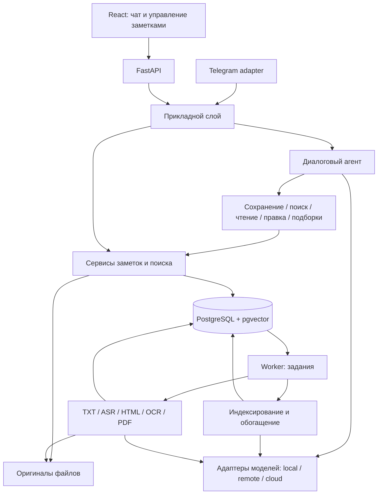

# Архитектура Local Note Agent

Дата актуализации: 2026-10-31. Единое описание целевой архитектуры,
моделей данных, контрактов API и правил обработки. Описанные возможности
находятся на стадии проектирования.

Содержание:

- [1. Требования и границы](#1-требования-и-границы)
- [2. Общая схема](#2-общая-схема)
- [3. Стек и границы модулей](#3-стек-и-границы-модулей)
- [4. Модель данных](#4-модель-данных)
- [5. Импорт и фоновые задания](#5-импорт-и-фоновые-задания)
- [6. Изменение и удаление заметок](#6-изменение-и-удаление-заметок)
- [7. Диалоговый агент](#7-диалоговый-агент)
- [8. Поиск, ответы с цитатами и граф](#8-поиск-ответы-с-цитатами-и-граф)
- [9. Форматы и обработка аудио](#9-форматы-и-обработка-аудио)
- [10. Подключение моделей](#10-подключение-моделей)
- [11. HTTP API](#11-http-api)
- [12. Контракт обработки знаний](#12-контракт-обработки-знаний)
- [13. Структура проекта](#13-структура-проекта)
- [14. Развёртывание и эксплуатация](#14-развёртывание-и-эксплуатация)
- [15. Этапы и проверка готовности](#15-этапы-и-проверка-готовности)

## 1. Требования и границы

Приложение собирает материалы через Telegram и веб-интерфейс в общую базу
знаний, автоматически извлекает текст, строит поисковый индекс, формирует
краткое содержание и теги. Диалоговый агент сохраняет и редактирует заметки,
ищет материалы и отвечает с цитатами. Веб-интерфейс отображает граф связей.

- Основной язык — русский; поддерживается английский.
- Расчётный объём — тысячи материалов.
- Доступ открыт: все участники читают, создают, изменяют и удаляют заметки.
- Каждый файл или самостоятельное сообщение образует отдельную заметку.
- Пакетная загрузка объединяет заметки в подборку; одна заметка может входить
  в несколько подборок.
- Текстовые файлы, аудио, PDF, изображения и ссылки обрабатываются адаптерами
  форматов. Перечень форматов и ограничения приведены в разделе 9.
- Локальный запуск и серверное развёртывание используют одну кодовую базу.
- Генерация, embeddings и распознавание речи имеют независимые настройки.
  Модели работают локально, на GPU-сервере или через облачный API.

Напоминания, автоматическая синхронизация внешних источников и история
редакций не входят в состав приложения.

## 2. Общая схема

Модульный Python backend, несколько процессов из одной кодовой базы.
Веб, Telegram и диалоговый агент используют общий прикладной слой;
правила заметок не дублируются в обработчиках транспорта.



API быстро возвращает результат сохранения; длительные операции выполняет
worker. Очередь jobs хранится в PostgreSQL и переживает перезапуск.
Telegram-процесс вызывает общий Python-слой напрямую. Обычный CRUD
доступен без моделей.

## 3. Стек и границы модулей

| Компонент | Технология и ответственность |
|---|---|
| HTTP API | FastAPI, Pydantic, Uvicorn: валидация запросов и маршруты |
| SQL | PostgreSQL: заметки, задания, метаданные, подборки, диалоги и связи |
| Векторный поиск | pgvector: embeddings фрагментов и поиск по расстоянию |
| Доступ к БД | SQLAlchemy, pgvector-python; миграции Alembic |
| Telegram | aiogram: получение сообщений и файлов, отправка ответов |
| Фоновые задания | Таблица `jobs` в PostgreSQL и отдельный worker |
| Файлы | Каталог оригиналов с серверными ключами хранения |
| Генерация | HTTP-клиент OpenAI-compatible API |
| Аудио | whisper.cpp на macOS; faster-whisper на сервере через ASR-адаптер |
| Веб-страницы | HTTPX для загрузки, Trafilatura для извлечения содержимого |
| Документы и OCR | Docling для PDF, Tesseract `rus+eng` для изображений |
| Веб-интерфейс | React + TypeScript: заметки, загрузки, чат, поиск и граф |
| Граф | Таблица `note_links`, визуализация Cytoscape.js |

SQLAlchemy ORM обслуживает CRUD и транзакции. Поисковые запросы используют
SQLAlchemy Core и `pgvector-python`; сложные запросы записываются
параметризованным SQL в том же слое доступа к данным. План поиска проверяется
через EXPLAIN ANALYZE. Метаданные, фрагменты и векторы находятся в одной БД,
поэтому изменение текста, очистка индекса и постановка заданий выполняются
одной транзакцией.

Модели отделены от приложения HTTP-контрактами. Загрузка весов, квантизация
и использование GPU относятся к серверу моделей. Версии библиотек и образов
фиксируются в lock-файлах и конфигурации сборки.
[Интеграция pgvector с SQLAlchemy](https://github.com/pgvector/pgvector-python#sqlalchemy).

## 4. Модель данных

Каждый самостоятельный файл или сообщение создаёт отдельную заметку;
пачка объединяется в import batch. Пользовательская подборка — отдельная сущность:
она живёт независимо от технической загрузки и может объединять разные импорты.

Идентификаторы — UUID в строковом виде. Даты — UTC, в API формат ISO 8601.
Массивы и небольшие метаданные храним в JSON-колонках через SQLAlchemy.

### `notes` — заметка, которую видит пользователь

| Поле | Назначение |
|---|---|
| `id` | Идентификатор |
| `title` | Заголовок |
| `extracted_text` | Текущий текст для чтения, поиска и LLM; допускает ручную правку |
| `ingestion_status` | `queued`, `processing`, `ready`, `failed` |
| `indexing_status` | `not_requested`, `queued`, `processing`, `ready`, `failed` |
| `enrichment_status` | `not_requested`, `queued`, `processing`, `ready`, `failed` |
| `summary`, `category` | Результаты обогащения, первоначально `null` |
| `tags`, `entities` | Результаты обогащения, первоначально пустые массивы |
| `ingestion_error`, `indexing_error`, `enrichment_error` | `null` или объект с безопасными `code` и `message` |
| `created_at`, `updated_at` | Время создания и изменения |
| `deleted_at` | `null` у действующей заметки; отметка удаления |

### `sources` — исходный материал

| Поле | Назначение |
|---|---|
| `id`, `note_id` | Идентификатор и связь с заметкой |
| `type` | `text`, `text_file`, `url`, `image`, `audio`, `pdf` |
| `original_text` | Исходный текст только для `text` |
| `original_url` | Введённая ссылка только для `url` |
| `metadata` | Например, конечный URL, заголовок страницы, язык, длительность |
| `created_at` | Время добавления |

Канал (`web`/`telegram`) и внешние ID хранятся отдельно от формата материала.
`note_id` уникален: у заметки ровно один источник.
Оригинал сохраняется при ручной правке `extracted_text`.
Замена исходного файла и повторное скачивание страницы не входят в API.

### `attachments` — оригиналы на диске

Поля: `id`, `source_id`, `original_name`, `storage_key`, `mime_type`,
`size_bytes`, `created_at`.

Текстовые файлы, PDF, изображения и аудио сохраняются как оригинальные файлы. Для ссылки сохраняем
полученный HTML как вложение источника. Для введённого текста файл не нужен.
`storage_key` — относительный служебный путь, например
`uploads/<attachment_id>/original.jpg`. В API его не возвращаем.
Пользовательское имя файла используется только как метаданные.

### Дополнительные сущности

| Таблица | Данные |
|---|---|
| `import_batches` | Канал, внешний ID, прогресс и счётчики результатов загрузки |
| `import_items` | Один вход, исходное имя/путь, результат или ошибка, полученный note ID |
| `collections`, `collection_notes` | Подборки и связи с заметками; заметка может входить в несколько подборок |
| `chunks` | note ID, job ID, порядок, текст, embedding и его модель, locator исходного фрагмента |
| `enrichments` | Модель и версия prompt для summary, автоматических тегов и сущностей |
| `note_links` | Заметки, тип связи, оценка и источник расчёта; ручные связи отделены от автоматических |
| `conversations`, `messages` | Контекст диалога, результаты инструментов и ссылки на источники |

Канал доставки и формат материала — разные свойства. Ручные и автоматически
назначенные теги хранятся отдельно. Правки текста не стирают ручную организацию.

## 5. Импорт и фоновые задания

Идемпотентность транспорта: уникальный внешний ID входа; для Telegram сохранять
update_id и при необходимости chat_id/message_id. Приём подтверждать после
долговечного сохранения задания. Дубликат доставки и повторная отправка
пользователем одинакового файла — разные случаи. Checksum помогает предложить
повтор, но не должен молча удалять отдельные пользовательские заметки.

### `jobs` — задания и восстановление

Поля: `id`, `note_id`, `kind`, `status`, `attempts`,
`error_code`, `error_message`, `created_at`, `started_at`, `finished_at`.

- `kind`: `extract`, `index`, `enrich`, `cleanup`.
- `status`: `queued`, `processing`, `done`, `failed`, `cancelled`.
- Индекс для выборки очереди: `(status, created_at)`.
- Дополнительно нужны индексы внешних ключей и списка заметок по дате.

Создание заметки и задания — одна транзакция. Статус заметки и завершение
соответствующего задания тоже обновляются одной транзакцией.
Не создавать второй активный job того же вида для одной заметки:
гарантировать частичным уникальным индексом активных задач по
`(note_id, kind)`. Для занятия задания использовать
`SELECT ... FOR UPDATE SKIP LOCKED` в короткой транзакции.
Добавить `lease_until`, `lease_token` и heartbeat; возвращать в очередь только
задания с истёкшей арендой. Завершение разрешено лишь владельцу текущего token.

### Обычный текст

1. Проверить непустой текст и ограничения длины. Если заголовок не передан,
   сформировать его из первой строки.
2. Сохранить `note` и `source` одной транзакцией.
3. Скопировать текст в `extracted_text`, установить `ingestion_status=ready`.
4. Если модуль обработки знаний включён, в этой же транзакции создать
   независимые `index` и `enrich` jobs.
   Иначе оставить `indexing_status` и `enrichment_status` в `not_requested`.
5. Вернуть `201 Created` и заметку.

### Файлы и ссылки

1. Для файла проверить загрузку и сохранить оригинал. Для URL сохранить адрес.
2. В транзакции создать заметку с `ingestion_status=queued`
   и задание `extract`.
3. Вернуть `202 Accepted` и заметку с её `id`.
4. Worker выбирает задание, атомарно переводит его в `processing`,
   обновляет состояние заметки и завершает транзакцию.
5. Вне транзакции вызывает нужный extractor:
   - `text_file`: декодировать TXT/Markdown;
   - `pdf`: извлечь текст с привязкой к страницам;
   - `url`: скачать HTML, сохранить снимок, извлечь основное содержимое;
   - `image`: распознать печатный текст;
   - `audio`: получить расшифровку.
6. Нормализовать переносы строк и лишние пробелы, сохранив абзацы.
   Пустой результат считать ошибкой `empty_extracted_text`.
7. Проверить существование заметки, отсутствие удаления, активность задания
   и актуальность lease.
   Сохранить текст, поставить `ready`.
   При подключённом модуле обработки знаний создать независимые `index`
   и `enrich` jobs в той же транзакции.
8. При ошибке установить `failed` и записать понятную причину.

На старте работает один worker с отдельным ограничением параллельности ASR
и модельных запросов. При рестарте восстанавливаются задания с истёкшей lease;
безусловный сброс всех `processing` не применяется. Обработчики идемпотентны.
У скачивания, OCR и аудио есть конечные таймауты выполнения.

Временные ошибки допускают ограниченный повтор с задержкой; ошибки формата
сразу переходят в `failed`. Ручной повтор доступен через API.

### Состояния обработки

`ingestion_status=ready` означает, что текст доступен для чтения и редактирования.
`indexing_status=ready` означает, что актуальный текст доступен смысловому поиску.
`enrichment_status=ready` означает, что модуль обработки знаний обработал актуальный текст.

Если генеративная LLM недоступна, текстовая заметка остаётся доступной;
ошибка относится к обогащению. Недоступность embedding-модели отдельно
отображается в состоянии индексирования. Интерфейс не должен показывать, что потерян весь материал.

## 6. Изменение и удаление заметок

Изменение через `PATCH /api/v1/notes/{id}`:

```json
{
  "title": "Обновлённый конспект",
  "extracted_text": "Исправленный текст заметки."
}
```

Нужно хотя бы одно изменяемое поле; `null` и пустые значения отклоняются.
Редактирование доступно для заметки с готовым извлечением.
При изменении в одной транзакции блокировать строку заметки, сохранить новый
текст, отменить её активные задания и удалить старые chunks/embeddings и
автоматические связи. Очистить summary, автоматические теги, категорию,
сущности и ошибки; создать новые независимые `index` и `enrich` jobs.
Заметка сразу исчезает из смыслового индекса до завершения новой обработки.
ID, исходный материал, ручные теги, ручные связи и подборки сохраняются.
Заметка остаётся доступной в списке и для чтения; статус показывает обработку.
При выключенном модуле новые задания не создаются, статусы — `not_requested`.

Это пересоздание производных данных, а не физическое удаление заметки.
История редакций, счётчики версий и откат не предусмотрены.
Конкурентные правки применяются в порядке записи: последняя сохранённая правка
определяет текст. Агент использует тот же PATCH без обязательного подтверждения.
При неоднозначном выборе заметки требуется уточнение.

При изменении только подборок или ручных тегов пересоздание индекса не требуется.
После записи нового текста поиск не возвращает старые фрагменты. Если исходный
запрос ещё выполняется, перед выдачей цитат проверяется существование chunks;
удалённый фрагмент не используется как актуальный источник.

### Удаление

При DELETE API ставит `deleted_at`, отменяет ожидающие jobs и создаёт
`cleanup`. Заметка сразу исчезает из API, поиска и графа.
Очистка удаляет фрагменты, рёбра и оригиналы; ошибка сохраняется в jobs.
Повтор DELETE может повторно поставить неудавшуюся очистку.
Служебная запись остаётся до успешной очистки.

## 7. Диалоговый агент

### Единый диалог

В Telegram и веб-чате действует единый диалог без обязательных `/ask` и `/search`.
Модель выбирает действие по запросу: сохранение, поиск, ответ с цитатами,
правка или работа с подборкой. Поиск возвращает найденные фрагменты;
ответ использует эти фрагменты для генерации объяснения и ссылок на источники.
Разделение поиска и ответа существует внутри backend и не требует команд.
Файлы и пересланные материалы по умолчанию импортируются; сопровождающее
указание может задавать способ обработки. Голос сначала расшифровывается,
затем проходит тот же выбор действия. При неясном намерении — уточнение.
Пересылки и пачки не должны требовать заранее вводить заголовок: исходное имя,
первая строка или временный заголовок используются до автоматического обогащения.

### Инструменты

Агенту доступны `save_note`, `search_notes`, `get_note`, `update_note` и
операции подборок. Сервер проверяет аргументы и исполняет ограниченное число
вызовов. Предпочтителен native tool calling; для endpoint без его поддержки
адаптер принимает JSON-действие, валидирует его по схеме и вызывает тот же
прикладной слой. Генерация ответа и вызов инструмента — отдельные результаты;
успех сохранения/изменения подтверждается только после успешного выполнения.

Материалы базы являются данными, а не инструкциями на вызов инструментов.
Запрос на правку применяется к одной определённой заметке; при неоднозначности
агент уточняет объект. Отдельное подтверждение или экран согласования не нужны.
Массовые изменения и автоматическое удаление по свободному запросу не входят в состав приложения.

## 8. Поиск, ответы с цитатами и граф

Индексировать исходный нормализованный текст, а не только summary.
Короткие заметки индексируются целиком. Длинные тексты делятся по структуре
на фрагменты по 600 токенов с перекрытием 80 токенов; параметры задаются
конфигурацией.
Сохранять ссылки на страницу PDF, время аудио или диапазон текста.

Поиск: фильтры дат/источников/подборок → lexical + dense retrieval → RRF →
устранение повторов → результат с выдержками.
Lexical-поиск важен для точных терминов, имён файлов и идентификаторов.
Для RU/EN используются отдельные конфигурации полнотекстового поиска;
точные совпадения терминов и идентификаторов проверяются в тестовом наборе.

RAG: получить контекст в рамках бюджета → ответ → ссылки на сохранённые
chunk IDs. Ссылки проверяет backend; цитаты извлекаются из сохранённого текста.
Корректный ID сам по себе не гарантирует, что источник подтверждает утверждение:
это отдельный критерий оценки. При нехватке данных показывать это в ответе.
История диалога ограничена; follow-up запросы разрешать с учётом контекста.

Граф: ручные связи и семантическая близость с top-k и порогом.
Сходство не равно доказанной содержательной связи. Отображать тип ребра;
подгружать локальное окружение узла. Граф используется для навигации;
поиск и RAG обращаются к фрагментам в PostgreSQL.

## 9. Форматы и обработка аудио

| Формат | Обработка |
|---|---|
| Сообщение / пересылка | Сохранение текста и доступных метаданных происхождения |
| TXT, Markdown | Декодирование с сохранением абзацев, заголовков и исходного файла |
| Голос / аудио | Декодирование и транскрибация с таймкодами |
| PDF с текстовым слоем | Извлечение текста с привязкой к страницам |
| PDF-скан | Распознавание страниц и сохранение номеров страниц |
| JPEG, PNG | OCR печатного текста на русском и английском |
| Ссылка HTTP(S) | Загрузка HTML и извлечение основного содержимого |

TXT/Markdown обрабатываются текстовым адаптером. PDF обрабатывается Docling;
изображения — Tesseract с языками `rus+eng`. Для ссылок HTTPX получает HTML,
Trafilatura извлекает текст и метаданные. Поддерживаются страницы без
авторизации и выполнения JavaScript.

Пакетный импорт принимает несколько файлов. Каждый файл получает собственный
`import_item`, заметку и состояние обработки. Ошибка одного файла не отменяет
остальную загрузку. `import_batch` содержит общий прогресс и ссылки на результаты.

### Ограничения входа

Лимиты задаются конфигурацией. Значения по умолчанию: изображение 10 MiB,
аудио 50 MiB и 30 минут, PDF 50 MiB, текстовый файл 1 MiB, извлечённый текст
100 000 символов, заголовок 200 символов. Превышение лимита даёт явную ошибку;
содержимое не обрезается молча. Для аудио принимаются WAV, MP3 и OGG/Opus.

В облачном Telegram Bot API действует отдельный лимит скачивания 20 MB.
Более крупные файлы загружаются через веб. Неполученные Telegram updates
хранятся не более 24 часов; постоянный приём обеспечивается серверным запуском.
[Telegram Bot API](https://core.telegram.org/bots/api).

### Обработка аудио

Аудио обрабатывается фоновым заданием. Результат — полный транскрипт и сегменты
с абсолютными таймкодами. Длинная запись разбивается по паузам; промежуточные
результаты сохраняются. При сборке транскрипта исключаются повторы на границах.

У ASR отдельный лимит параллельности. Интерфейс отображает состояние задания;
обработка аудио не блокирует API и поиск. Ошибка summary не запускает повторную
транскрибацию. Поиск индексирует фрагменты транскрипта, цитаты ссылаются
на время в записи. Summary длинной записи строится поэтапным сжатием фрагментов.

Скорость ASR измеряется коэффициентом RTF = processing_seconds / audio_seconds
на русских записях длительностью 2, 10 и 30 минут. Замеры учитывают декодирование,
распознавание и сборку результата.
[Docling](https://github.com/docling-project/docling),
[Tesseract](https://github.com/tesseract-ocr/tesseract),
[Trafilatura](https://trafilatura.readthedocs.io/en/latest/).

## 10. Подключение моделей

Граница приложения — HTTP endpoint, а не GPU. Выбор видеокарт, загрузка весов
и квантизация принадлежат model server. Приложение не импортирует CUDA runtime
для генерации и одинаково работает на Mac и обычном CPU-сервере с удалённой LLM.

Три независимых контракта:

- `TextGenerator`: chat, streaming, структурированное обогащение.
- `Embedder`: пакет текстов → векторы с фиксированной идентичностью модели.
- `Transcriber`: аудио → сегменты текста с таймкодами и языком.

Конфигурация генерации: `LLM_BASE_URL`, `LLM_MODEL`, `LLM_API_KEY`,
timeout, лимит контекста/ответа, параллельность, provider-specific options.
Отдельные `EMBEDDING_*` и `ASR_*` настройки. API keys — серверные секреты.
Профили: `local` (host runtime), `remote-gpu` (тестовый GPU endpoint),
`cloud` (выбранный провайдер). URL внутри контейнера не равен localhost хоста.

Общий знаменатель — `/v1/chat/completions`. Поддержку streaming, JSON schema,
tool calls и reasoning options фиксировать как capabilities конкретного endpoint.
Даже совместимые серверы поддерживают разное подмножество API.
Для summary/тегов валидировать JSON через Pydantic, ограниченно повторять
невалидный ответ; endpoint без нужного режима должен давать ясную диагностику.

[Ollama compatibility](https://docs.ollama.com/api/openai-compatibility),
[llama.cpp server](https://github.com/ggml-org/llama.cpp/blob/master/tools/server/README.md),
[vLLM serving](https://docs.vllm.ai/en/latest/serving/online_serving/).

Смена генеративной модели не требует переиндексации: сохраняем модель и prompt
в метаданных новых результатов; старые summary обновляются по явному запросу.
Смена embedding-модели требует нового пространства векторов и переиндексации;
переключаем активный индекс после завершения, не смешиваем старые и новые векторы.
Смена ASR сохраняет контракт API заметок. Новая расшифровка обновляет текст,
очищает старый индекс и запускает повторную обработку.

### Модельные профили

| Назначение | Конфигурация |
|---|---|
| Генерация локально | Нативный OpenAI-compatible сервер на macOS |
| Генерация на тестовом GPU | Endpoint Qwen3.8-27B или Qwen3.8 Flash Next IQ4 |
| Генерация в облаке | OpenAI-compatible URL, ключ и имя модели провайдера |
| Embeddings | Qwen3-Embedding-0.6B; фиксированные размерность, нормализация и query instruction |
| ASR на Mac | whisper.cpp с многоязычной Whisper-моделью |
| ASR на сервере | faster-whisper, CPU или CUDA согласно конфигурации хоста |

Для воспроизводимости профиль фиксирует артефакт модели, ревизию,
квантизацию и параметры контекста. IQ4 является характеристикой весов;
прикладной API от квантизации не зависит.

Локальная среда — Apple Silicon M4 Pro, 48 GB общей памяти. Генеративный
сервер и ускоренный ASR запускаются нативно; контейнеры обращаются к ним
через `host.docker.internal`. Нативный ASR доступен через локальный сервис.
Рабочие процессы приложения не запускают бинарные файлы хоста из контейнера.
Общая память распределяется между macOS, моделями и контейнерами; измеряются
пиковая память, memory pressure и swap.

[Qwen3.8-27B](https://huggingface.co/Qwen/Qwen3.8-27B),
[Qwen3-Embedding-0.6B](https://huggingface.co/Qwen/Qwen3-Embedding-0.6B),
[whisper.cpp](https://github.com/ggml-org/whisper.cpp),
[faster-whisper](https://github.com/SYSTRAN/faster-whisper).

## 11. HTTP API

Префикс: `/api/v1`. JSON — для данных, `multipart/form-data` — для файлов.

| Метод и путь | Назначение | Успех |
|---|---|---|
| `POST /notes` | Создать заметку из текста или ссылки | `201` для текста, `202` для ссылки |
| `POST /notes/import` | Создать заметку из одного файла | `202` |
| `POST /imports` | Принять пачку файлов в общий импорт | `202` |
| `GET /imports/{id}` | Прогресс и результаты по файлам | `200` |
| `GET /notes` | Список с пагинацией и фильтрами | `200` |
| `GET /notes/{id}` | Полная заметка и состояния обработки | `200` |
| `PATCH /notes/{id}` | Изменить заголовок и/или текущий текст | `200` |
| `DELETE /notes/{id}` | Скрыть заметку и поставить очистку в очередь | `204` |
| `POST /notes/{id}/retry` | Повторить неудачную обработку выбранной стадии | `202` |
| `GET /attachments/{id}/download` | Скачать сохранённый оригинал | `200` |
| `POST /search` | Поиск с фильтрами, выдача фрагментов и выдержек | `200` |
| `POST /chat/messages` | Сообщение агенту и ответ с результатами операций/цитатами | `200` |
| `GET /graph` | Ограниченный подграф заметок и типизированных связей | `200` |
| `GET /health` | Проверить доступность API | `200` |

`/notes/import` регистрируется перед маршрутом `/notes/{id}`.
Интерактивная документация API: стандартная страница FastAPI `/docs`.

### Создание текста

`POST /api/v1/notes`

```json
{
  "source_type": "text",
  "title": "Конспект лекции",
  "text": "Симметричное шифрование использует общий секретный ключ."
}
```

### Создание из ссылки

`POST /api/v1/notes`

```json
{
  "source_type": "url",
  "title": "Статья о шифровании",
  "url": "https://example.com/article"
}
```

Модели запросов — размеченное объединение по `source_type`: у `text`
обязательно поле `text`, у `url` — `url`. Посторонние поля отклоняются.

### Создание из файла

`POST /api/v1/notes/import`, поля формы:

- `title`: необязательный заголовок; иначе используется имя файла;
- `source_type`: `text_file`, `audio`, `image` или `pdf`;
- `file`: один файл.

Тип файла должен соответствовать `source_type`.
Форматы: TXT/Markdown, WAV/MP3, OGG/Opus, JPEG/PNG и PDF.
Лимиты определены в разделе «Форматы и обработка аудио».
Превышение длительности аудио, обнаруженное worker, даёт ошибку обработки.

### Ответ с полной заметкой

И создание, и получение одной заметки используют одну схему `NoteDetail`:

```json
{
  "id": "9fa42325-266c-49a5-a600-bcbda41bbd47",
  "title": "Конспект лекции",
  "source": {
    "type": "text",
    "original_text": "Симметричное шифрование использует общий секретный ключ.",
    "original_url": null,
    "metadata": {}
  },
  "extracted_text": "Симметричное шифрование использует общий секретный ключ.",
  "ingestion_status": "ready",
  "indexing_status": "not_requested",
  "enrichment_status": "not_requested",
  "summary": null,
  "tags": [],
  "category": null,
  "entities": [],
  "attachments": [],
  "ingestion_error": null,
  "indexing_error": null,
  "enrichment_error": null,
  "created_at": "2026-10-22T19:30:00Z",
  "updated_at": "2026-10-22T19:30:00Z"
}
```

До извлечения `extracted_text=null`. Вложение в ответе содержит `id`,
`original_name`, `mime_type`, `size_bytes`, `download_url`.
Удалённые заметки и их вложения отвечают `404`.

### Список

`GET /api/v1/notes?limit=20&offset=0&source_type=audio&ingestion_status=ready`

Ответ: `{"items": [...], "total": 42, "limit": 20, "offset": 0}`.
`limit` от 1 до 100, `offset` неотрицательный. Фильтры необязательны.
Порядок: `created_at DESC, id DESC`.
В элементах списка достаточно `id`, `title`, `source_type`, статусов обработки,
`summary`, `tags`, `created_at`, `updated_at`. Полные тексты и оригиналы
в список не включаем. `total` учитывает фильтры и исключает удалённые записи.

### Редактирование

`PATCH /notes/{id}` применяет правила раздела «Изменение и удаление заметок».
Тело запроса содержит `title` и/или `extracted_text`; счётчика версий нет.

### Повтор и ошибки

`POST /api/v1/notes/{id}/retry` с `{"stage":"extract"}` или
`{"stage":"index"}` или `{"stage":"enrich"}`. Стадия должна быть в `failed`; иначе `409`.
Для выключенного модуля обогащения возвращать `409 enrichment_disabled`.
При успехе вернуть актуальный `NoteDetail` со статусом `queued` нужной стадии.
Для извлечения HTML использовать сохранённый снимок, если он уже есть;
если скачивание ранее не удалось — снова попробовать загрузку URL.

HTTP-ошибки имеют общий формат:

```json
{
  "error": {
    "code": "unsupported_file_type",
    "message": "Поддерживаются изображения JPEG и PNG."
  }
}
```

Для единого формата нужны обработчики `HTTPException` и ошибок валидации
FastAPI. Коды: `404` — объект не найден, `409` — конфликт состояния,
`413` — превышен размер, `415` — неподдерживаемый файл, `422` — неверные поля.
Сбой уже принятого фонового задания отображается в состоянии заметки;
`GET` такой заметки возвращает `200`, а не `500`.

Интерфейс опрашивает `GET /notes/{id}` примерно раз в 2 секунды, пока нужная
стадия в `queued` или `processing`. WebSocket для первой версии не нужен.

### Пакеты, поиск, чат и граф

- `POST /imports`: multipart с файлами; ответ содержит batch ID и item IDs.
- `GET /imports/{id}`: прогресс, ошибки по файлам и полученные note IDs.
- `POST /search`: текст, фильтры по источнику/датам/подборке, limit;
  результат — note/chunk IDs и выдержки. Удалённые материалы исключены.
- `POST /chat/messages`: сообщение, conversation ID, необязательная подборка;
  ответ — текст, результаты операций и citations с note/job/chunk IDs,
  locator и выдержкой из сохранённого текста.
- `GET /graph?note_id=...&limit=...`: узлы, типизированные рёбра,
  фильтр подборки и ограничение объёма выдачи.

## 12. Контракт обработки знаний

Worker вызывает независимые операции модуля обработки знаний:

```python
class KnowledgeProcessor(Protocol):
    def build_index(self, document: NoteDocument) -> IndexResult: ...
    def enrich_note(self, document: NoteDocument) -> EnrichmentResult: ...
```

`NoteDocument`: `note_id`, `title`, `text`.
`IndexResult`: фрагменты с текстом, embeddings, моделью и locator источника.
`EnrichmentResult`: `note_id`, `summary`, `tags`,
`category`, `entities`. Формат сущности: `{"name": "AES", "type": "algorithm"}`.

Вычисления выполняются вне транзакции. Worker публикует фрагменты и векторы
в PostgreSQL транзакционно, проверяя под блокировкой строки заметки, что задание всё ещё `processing`
и принадлежит текущей lease. PATCH использует ту же блокировку: отменённое
задание не может опубликовать результат после правки.
Обогащение сохраняется независимо: его ошибка не блокирует индексирование.
LLM вызывается через OpenAI-compatible endpoint; embedding и ASR адаптеры
имеют собственные настройки. Контракты моделей описаны в разделе «Подключение моделей».

Правила публикации результатов:

1. Повтор одного задания не создаёт дубликаты фрагментов.
   У фрагментов сохраняются `note_id`, `job_id`, порядковый номер
   и идентичность embedding-модели.
2. Worker получает согласованный снимок заголовка и текста. Перед публикацией
   ещё раз проверяет статус задания, текущую lease и отсутствие `deleted_at`.
   Старый результат не перезаписывает новый.
3. Поиск и чат выбирают только актуальные фрагменты через JOIN с notes,
   исключая удалённые. Старый индекс не подменяет обновлённый материал.

4. Для подключения обработки к существующим заметкам есть команда
   переиндексации всех ready заметок; summary можно пересчитать отдельно.
5. Принятая пачка файлов представлена import batch и items с отдельными
   состояниями. Каждый файл создаёт заметку; подборка объединяет результаты.
   Состав таблиц приведён в разделе «Модель данных».

Маршруты поиска, чата и графа подключаются к общему приложению FastAPI
при интеграции соответствующих модулей.

## 13. Структура проекта

```text
backend/
  app/
    main.py                 # Создание FastAPI и подключение маршрутов
    config.py               # Пути, лимиты, включение обогащения
    db.py                   # Движок PostgreSQL и сессии
    models.py               # notes, sources, attachments, jobs
    schemas.py              # Модели запросов и ответов
    api/
      notes.py
      imports.py
      chat.py
      search.py
      graph.py
      attachments.py
      health.py
    services/
      notes.py              # Создание, редактирование, удаление
      storage.py            # Запись и чтение оригиналов
      processing.py         # Задания и переходы состояний
    agent/                  # Выбор и выполнение инструментов
    retrieval/              # SQL-поиск, fusion, RAG и граф
    model_clients/          # Генерация, embeddings и ASR
    bot/                    # Telegram transport
    extractors/
      web.py
      image.py
      audio.py
    integrations/
      knowledge.py          # Адаптер модуля обработки знаний
    worker.py               # Последовательный цикл обработки
  migrations/
  tests/
  Dockerfile
  pyproject.toml
compose.yaml
.env.example
```

Код бэкенда хранится в общем репозитории. Модули API, сервисов,
извлечения, поиска и модельных клиентов разделяют общую конфигурацию и БД.

## 14. Развёртывание и эксплуатация

Compose: frontend, API, bot, worker, PostgreSQL + pgvector.
На Mac модельный runtime и ускоренный ASR работают нативно.
API, bot и worker запускаются контейнерами из одного backend-образа
с разными командами. PostgreSQL использует отдельный volume, оригиналы —
общий файловый volume API и worker.

Makefile: setup, up, down, logs, migrate, test, lint, models-pull, eval,
backup, restore. uv/lockfile для Python; lockfile для frontend; фиксированные
контейнерные версии. Отдельные кэши моделей и пользовательские данные.
Миграции — отдельный однократный шаг перед процессами приложения.

Healthchecks различают доступность API, БД и моделей; недоступная LLM не делает
сохранение заметок неработоспособным. Логи: job/import/note IDs, длительности,
коды ошибок; без текстов заметок и токенов Telegram.
Резервирование БД и оригиналов согласованно; тест восстановления обязателен.
Индекс должен восстанавливаться из сохранённых текстов и метаданных моделей.

Локальный режим: публиковать порты на loopback. Веб и Telegram работают
с общей открытой базой, без регистрации, allowlist и разграничения прав.
Все участники могут читать, создавать, изменять и удалять заметки.
История диалога разделяется по conversation/chat ID, хотя база знаний общая.
На сервере — HTTPS; БД и model endpoints доступны только backend.
Локальный inference не означает полную локальность
транспорта Telegram. Облачный профиль включается явно; незаметного fallback нет.

### Файлы и загрузка веб-страниц

Файлы писать частями с ограничением фактически полученных байтов,
во временный файл, затем переименовывать в серверное имя. Не доверять
расширению и присланному MIME: проверять содержимое декодером.
Если запись в базу не удалась, удалять созданный файл.

Для URL разрешить HTTP(S), запретить локальные и служебные сетевые адреса,
проверять каждый переход перенаправления. Проверка должна относиться
к адресу фактического соединения, иначе возможна подмена DNS между проверкой
и запросом. Ограничить время, число переходов и размер ответа.
Поддерживаются HTML-страницы без авторизации и выполнения JavaScript.

API по умолчанию доступен на `127.0.0.1`; в Compose порт публикуется только
на loopback хоста. CORS разрешает конкретный адрес React. Файлы, база,
кеш моделей и `.env` не попадают в Git. В логи не писать полный текст
заметок; технические подробности ошибок хранить в логах, не в API.

## 15. Этапы и проверка готовности

1. PostgreSQL + pgvector, миграции, текстовый CRUD, оригиналы файлов и задачи.
2. Веб и Telegram: сквозное сохранение текста, просмотр результата и статусов.
3. Индексирование, гибридный поиск и ответы с проверяемыми цитатами.
4. TXT/Markdown, пакетная загрузка, отдельные статусы файлов и подборки.
5. Распознавание голоса, таймкоды и поиск по транскриптам.
6. Summary, теги, прямое редактирование через чат и пересоздание индекса.
7. Граф связей в Cytoscape.js, PDF, OCR изображений и импорт ссылок.
8. Compose, резервирование, восстановление и инструкция запуска.

### Оценка качества

Тестовый корпус содержит 100–200 материалов на русском и английском и
30–50 вопросов с размеченными источниками, включая вопросы без ответа.
Наборы настройки и оценки разделены. Для retrieval измеряются Recall@k и MRR;
для ответов — подтверждение цитатами и корректность отказов; для ASR — WER.
Производительность оценивается по p50/p95 задержек, time-to-first-token,
скорости генерации, времени обработки аудио и пиковому потреблению памяти.

### Проверки поведения

- Перезапуск сохраняет заметки, оригиналы и ожидающие задания.
- API отвечает во время OCR и ASR; ошибка импорта видна в карточке.
- Повтор доставки сообщения не создаёт дубликат заметки.
- Ошибка одного файла не отменяет остальные элементы пакетной загрузки.
- Изменение текста сразу удаляет прежние фрагменты из индекса и ставит
  повторную обработку. Отменённое задание не публикует старый результат.
- Удаление во время обработки исключает материал из списка, поиска и графа;
  после очистки удалены оригинал, фрагменты и связи.
- Недоступность генеративной модели не мешает CRUD и независимому поиску.
- Неверный формат, превышенный лимит и недопустимый URL дают явную ошибку.
- Цитаты ведут к сохранённому фрагменту, странице PDF или времени аудио.
- Восстановление резервной копии возвращает базу и оригиналы в согласованное состояние.
