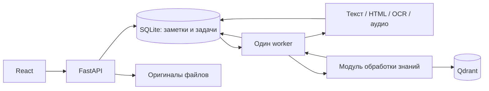

# Архитектура бэкенда

Статус: предложение архитектуры и контрактов для обсуждения с командой.
Это проектирование, а не описание уже реализованных возможностей.

## 1. Назначение бэкенда

Принимать текст, ссылку, изображение или аудио; сохранять оригинал; получать
обычный текст; отдавать заметку интерфейсу и модулю обработки знаний.

Первую работающую версию строим для одного локального пользователя.
В ней достаточно одного исходного материала на заметку. Дополнительные
вложения и объединение нескольких источников можно добавить позже.

Бэкенд должен запускаться и работать с заметками без LLM и Qdrant.

## 2. Общая схема



`api` и `worker` — два процесса одного Python-проекта, с общими моделями
данных и функциями доступа к SQLite. Модули подключаются внутри общего
приложения.

API принимает запросы и быстро возвращает результат сохранения.
Worker читает задания из SQLite и выполняет длительную обработку.
Очередь в базе позволяет сохранить задания между перезапусками.

## 3. Чем реализовать

| Задача | Предложение |
|---|---|
| HTTP API | FastAPI, Pydantic, Uvicorn |
| Работа с SQLite | SQLAlchemy, обычные синхронные сессии |
| Изменения схемы базы | Alembic |
| Загрузка файлов | FastAPI `UploadFile`, `python-multipart` |
| Получение HTML | HTTPX с таймаутами и ограничением размера ответа |
| Извлечение статьи из HTML | Trafilatura |
| Текст с изображения | Tesseract с языками `rus+eng`, Python-обёртка |
| Расшифровка аудио | faster-whisper, сначала небольшая модель на CPU |
| Фоновые задания | Таблица `jobs` и один отдельный worker |
| Запуск | Docker Compose: `api` и `worker` |

Это предложенный стек. Версии нужно зафиксировать при реализации.
OCR и аудио подключаются после работающего CRUD и импорта ссылок.
Качество русского OCR и скорость аудио проверяются на тестовых материалах.

Для SQLite включить `foreign_keys=ON` на каждом соединении, WAL и
`busy_timeout`. Транзакции держать короткими: сетевые запросы, OCR и вызовы
моделей выполнять вне транзакции. База и её служебные файлы находятся на
локальном диске одного хоста, в общем volume для API и worker.

FastAPI поддерживает `BackgroundTasks`, но для этой схемы выбираем отдельный
worker: у задания будет постоянная запись в базе, а обработку аудио можно
перезапускать независимо от API. Redis и Celery в первой версии не требуются.

## 4. Данные

Идентификаторы — UUID в строковом виде. Даты — UTC, в API формат ISO 8601.
Массивы и небольшие метаданные храним в JSON-колонках через SQLAlchemy.

### `notes` — заметка, которую видит пользователь

| Поле | Назначение |
|---|---|
| `id` | Идентификатор |
| `title` | Заголовок |
| `extracted_text` | Текущий текст для чтения, поиска и LLM; допускает ручную правку |
| `content_version` | Версия заголовка и текста для защиты от устаревшей обработки |
| `ingestion_status` | `queued`, `processing`, `ready`, `failed` |
| `enrichment_status` | `not_requested`, `queued`, `processing`, `ready`, `failed` |
| `enrichment_version` | Для какой версии сохранены результаты обогащения; иначе `null` |
| `summary`, `category` | Результаты обогащения, первоначально `null` |
| `tags`, `entities` | Результаты обогащения, первоначально пустые массивы |
| `ingestion_error`, `enrichment_error` | `null` или объект с безопасными `code` и `message` |
| `created_at`, `updated_at` | Время создания и изменения |
| `deleted_at` | `null` у действующей заметки; отметка удаления |

### `sources` — исходный материал

| Поле | Назначение |
|---|---|
| `id`, `note_id` | Идентификатор и связь с заметкой |
| `type` | `text`, `url`, `image`, `audio` |
| `original_text` | Исходный текст только для `text` |
| `original_url` | Введённая ссылка только для `url` |
| `metadata` | Например, конечный URL, заголовок страницы, язык, длительность |
| `created_at` | Время добавления |

В первой версии `note_id` уникален: у заметки ровно один источник.
Оригинал сохраняется при ручной правке `extracted_text`.
Замена исходного файла и повторное скачивание страницы пока не входят в API.

### `attachments` — оригиналы на диске

Поля: `id`, `source_id`, `original_name`, `storage_key`, `mime_type`,
`size_bytes`, `created_at`.

Изображения и аудио сохраняем как оригинальные файлы. Для ссылки сохраняем
полученный HTML как вложение источника. Для введённого текста файл не нужен.
`storage_key` — относительный служебный путь, например
`uploads/<attachment_id>/original.jpg`. В API его не возвращаем.
Пользовательское имя файла используется только как метаданные.

### `jobs` — задания обработки

Поля: `id`, `note_id`, `kind`, `input_version`, `status`, `attempts`,
`error_code`, `error_message`, `created_at`, `started_at`, `finished_at`.

- `kind`: `extract`, `enrich`, `cleanup`.
- `status`: `queued`, `processing`, `done`, `failed`, `cancelled`.
- `input_version`: версия входных данных; для `cleanup` может быть `null`.
- Индекс для выборки очереди: `(status, created_at)`.
- Дополнительно нужны индексы внешних ключей и списка заметок по дате.

Создание заметки и задания — одна транзакция. Статус заметки и завершение
соответствующего задания тоже обновляются одной транзакцией.
Не создавать второй активный job того же вида для той же версии заметки:
проверку делать в транзакции с блокировкой записи SQLite.

## 5. Как проходит обработка

### Обычный текст

1. Проверить непустой заголовок и текст, ограничения длины.
2. Сохранить `note` и `source` одной транзакцией.
3. Скопировать текст в `extracted_text`, установить `ingestion_status=ready`,
   `content_version=1`.
4. Если модуль обработки знаний включён, в этой же транзакции создать `enrich` job.
   Иначе оставить `enrichment_status=not_requested`.
5. Вернуть `201 Created` и заметку.

### Ссылка, изображение, аудио

1. Для файла проверить загрузку и сохранить оригинал. Для URL сохранить адрес.
2. В транзакции создать заметку с `ingestion_status=queued`,
   `content_version=0` и задание `extract`.
3. Вернуть `202 Accepted` и заметку с её `id`.
4. Worker выбирает задание, атомарно переводит его в `processing`,
   обновляет состояние заметки и завершает транзакцию.
5. Вне транзакции вызывает нужный extractor:
   - `url`: скачать HTML, сохранить снимок, извлечь основное содержимое;
   - `image`: распознать печатный текст;
   - `audio`: получить расшифровку.
6. Нормализовать переносы строк и лишние пробелы, сохранив абзацы.
   Пустой результат считать ошибкой `empty_extracted_text`.
7. Проверить, что заметка существует, не удалена и версия ещё актуальна.
   Сохранить текст, увеличить версию до `1`, поставить `ready`.
   При подключённом модуле обработки знаний создать `enrich` job в той же транзакции.
8. При ошибке установить `failed` и записать понятную причину.

Один worker обрабатывает задания последовательно. При его перезапуске
оставшиеся `processing` задания возвращаются в `queued`; это допустимо
только пока гарантирован ровно один worker без перекрывающихся запусков.
Обработчики должны переносить повторное выполнение без дублирования данных.
У скачивания, OCR и аудио нужны конечные таймауты выполнения.

Начальная политика: ошибки показываем пользователю, повтор запускается
вручную через API. Автоматические повторения и несколько worker — следующий этап.

### Что означают два статуса

`ingestion_status=ready` означает, что текст доступен для чтения и редактирования.
`enrichment_status=ready` означает, что модуль обработки знаний обработал текущую версию.

Если LLM недоступна, текстовая заметка остаётся доступной; ошибка относится
только к обогащению. Интерфейс не должен показывать, что потерян весь материал.

## 6. HTTP API

Префикс: `/api/v1`. JSON — для данных, `multipart/form-data` — для файлов.

| Метод и путь | Назначение | Успех |
|---|---|---|
| `POST /notes` | Создать заметку из текста или ссылки | `201` для текста, `202` для ссылки |
| `POST /notes/import` | Создать заметку из изображения или аудио | `202` |
| `GET /notes` | Список с пагинацией и фильтрами | `200` |
| `GET /notes/{id}` | Полная заметка и состояния обработки | `200` |
| `PATCH /notes/{id}` | Изменить заголовок и/или текущий текст | `200` |
| `DELETE /notes/{id}` | Скрыть заметку и поставить очистку в очередь | `204` |
| `POST /notes/{id}/retry` | Повторить неудачную обработку выбранной стадии | `202` |
| `GET /attachments/{id}/download` | Скачать сохранённый оригинал | `200` |
| `GET /health` | Проверить доступность API | `200` |

`/notes/import` регистрируется перед маршрутом `/notes/{id}`.
Интерактивная документация API: стандартная страница FastAPI `/docs`.

### Создание текста

`POST /api/v1/notes`

```json
{
  "source_type": "text",
  "title": "Конспект лекции",
  "text": "Симметричное шифрование использует общий секретный ключ."
}
```

### Создание из ссылки

`POST /api/v1/notes`

```json
{
  "source_type": "url",
  "title": "Статья о шифровании",
  "url": "https://example.com/article"
}
```

Модели запросов — размеченное объединение по `source_type`: у `text`
обязательно поле `text`, у `url` — `url`. Посторонние поля отклоняются.

### Создание из файла

`POST /api/v1/notes/import`, поля формы:

- `title`: заголовок;
- `source_type`: `image` или `audio`;
- `file`: один файл.

Тип файла должен соответствовать `source_type`.
Первоначальные форматы: JPEG/PNG и WAV/MP3.
Предлагаемые настраиваемые лимиты: изображение 10 MiB, аудио 50 MiB
и 10 минут, текст 100 000 символов, заголовок 200 символов.
Превышение длительности аудио, обнаруженное worker, даёт ошибку обработки.

### Ответ с полной заметкой

И создание, и получение одной заметки используют одну схему `NoteDetail`:

```json
{
  "id": "9fa42325-266c-49a5-a600-bcbda41bbd47",
  "title": "Конспект лекции",
  "source": {
    "type": "text",
    "original_text": "Симметричное шифрование использует общий секретный ключ.",
    "original_url": null,
    "metadata": {}
  },
  "extracted_text": "Симметричное шифрование использует общий секретный ключ.",
  "content_version": 1,
  "ingestion_status": "ready",
  "enrichment_status": "not_requested",
  "enrichment_version": null,
  "summary": null,
  "tags": [],
  "category": null,
  "entities": [],
  "attachments": [],
  "ingestion_error": null,
  "enrichment_error": null,
  "created_at": "2026-10-22T19:30:00Z",
  "updated_at": "2026-10-22T19:30:00Z"
}
```

До извлечения `extracted_text=null`. Вложение в ответе содержит `id`,
`original_name`, `mime_type`, `size_bytes`, `download_url`.
Удалённые заметки и их вложения отвечают `404`.

### Список

`GET /api/v1/notes?limit=20&offset=0&source_type=audio&ingestion_status=ready`

Ответ: `{"items": [...], "total": 42, "limit": 20, "offset": 0}`.
`limit` от 1 до 100, `offset` неотрицательный. Фильтры необязательны.
Порядок: `created_at DESC, id DESC`.
В элементах списка достаточно `id`, `title`, `source_type`, двух статусов,
`summary`, `tags`, `created_at`, `updated_at`. Полные тексты и оригиналы
в список не включаем. `total` учитывает фильтры и исключает удалённые записи.

### Редактирование

`PATCH /api/v1/notes/{id}`

```json
{
  "expected_version": 1,
  "title": "Обновлённый конспект",
  "extracted_text": "Исправленный текст заметки."
}
```

Нужно хотя бы одно изменяемое поле; `null` и пустые значения отклоняются.
На первом этапе редактировать можно только заметку с готовым извлечением.
При несовпадении версии вернуть `409`, чтобы не затереть чужое изменение.
Если значения изменились, увеличить `content_version`, очистить старые
summary/теги/категорию/сущности и `enrichment_version`, сбросить ошибку
обогащения, поставить новое задание для модуля обработки знаний, если он подключён.
Исходный текст или файл при этом сохраняется.

### Повтор и ошибки

`POST /api/v1/notes/{id}/retry` с `{"stage":"extract"}` или
`{"stage":"enrich"}`. Стадия должна быть в `failed`; иначе `409`.
Для выключенного модуля обогащения возвращать `409 enrichment_disabled`.
При успехе вернуть актуальный `NoteDetail` со статусом `queued` нужной стадии.
Для извлечения HTML использовать сохранённый снимок, если он уже есть;
если скачивание ранее не удалось — снова попробовать загрузку URL.

HTTP-ошибки имеют общий формат:

```json
{
  "error": {
    "code": "unsupported_file_type",
    "message": "Поддерживаются изображения JPEG и PNG."
  }
}
```

Для единого формата нужны обработчики `HTTPException` и ошибок валидации
FastAPI. Коды: `404` — объект не найден, `409` — конфликт состояния/версии,
`413` — превышен размер, `415` — неподдерживаемый файл, `422` — неверные поля.
Сбой уже принятого фонового задания отображается в состоянии заметки;
`GET` такой заметки возвращает `200`, а не `500`.

Интерфейс опрашивает `GET /notes/{id}` примерно раз в 2 секунды, пока нужная
стадия в `queued` или `processing`. WebSocket для первой версии не нужен.

## 7. Интеграция с модулем обработки знаний

Worker вызывает модуль обработки знаний через Python-интерфейс адаптера:

```python
class KnowledgeProcessor(Protocol):
    def upsert_note(self, document: NoteDocument) -> EnrichmentResult: ...
    def delete_note(self, note_id: str) -> None: ...
```

`NoteDocument`: `note_id`, `content_version`, `title`, `text`.
`EnrichmentResult`: `note_id`, `content_version`, `summary`, `tags`,
`category`, `entities`. Формат сущности: `{"name": "AES", "type": "algorithm"}`.

Модуль обработки знаний внутри `upsert_note` строит фрагменты, обновляет
Qdrant и рассчитывает результаты. Worker сохраняет возвращённые результаты
в SQLite. Адаптер может быть обычным Python-модулем, а позднее — клиентом
HTTP-сервиса; менять API заметок из-за этого не потребуется.

Правила, которые нужны уже при первой интеграции:

1. Обработка одной версии должна быть идемпотентной: повтор не создаёт копии
   фрагментов. В Qdrant сохраняются `note_id` и `content_version`.
2. Worker получает согласованный снимок заголовка и текста. Устаревшее
   задание отменяется. После ответа ещё раз проверяется актуальная версия
   и отсутствие `deleted_at`; старый результат не перезаписывает новый.
3. Модули поиска и чата проверяют найденные `note_id` и версии по SQLite,
   исключают удалённые и устаревшие результаты. Полной выдача становится
   после успешного обновления индекса.
4. При `DELETE` API ставит `deleted_at`, отменяет ожидающие задания обработки
   и создаёт `cleanup`. Заметка сразу пропадает из API и поиска.
   Последовательный worker после текущего задания удаляет её точки из
   Qdrant и оригинальные файлы. Ошибка очистки сохраняется в `jobs`;
   повторный `DELETE` для такой записи может повторно поставить очистку.
   Служебная запись остаётся до успешной очистки, поэтому перезапуск её не теряет.
5. Если модуль обработки знаний отключён, новых заданий `enrich` нет.
   Для подключения к уже созданным заметкам понадобится отдельная команда
   переиндексации всех `ready` заметок; это часть интеграции с модулем обработки знаний.

Маршруты поиска, чата и графа подключаются к общему приложению FastAPI
при интеграции соответствующих модулей.

## 8. Структура проекта

```text
backend/
  app/
    main.py                 # Создание FastAPI и подключение маршрутов
    config.py               # Пути, лимиты, включение обогащения
    db.py                   # Движок SQLite и сессии
    models.py               # notes, sources, attachments, jobs
    schemas.py              # Модели запросов и ответов
    api/
      notes.py
      attachments.py
      health.py
    services/
      notes.py              # Создание, редактирование, удаление
      storage.py            # Запись и чтение оригиналов
      processing.py         # Задания и переходы состояний
    extractors/
      web.py
      image.py
      audio.py
    integrations/
      knowledge.py          # Адаптер модуля обработки знаний
    worker.py               # Последовательный цикл обработки
  migrations/
  tests/
  Dockerfile
  pyproject.toml
compose.yaml
.env.example
```

Код бэкенда хранится в общем репозитории. На первом этапе достаточно
этой структуры; дополнительные слои выделяются по мере роста кода.

## 9. Что учесть в реализации

Файлы писать частями с ограничением фактически полученных байтов,
во временный файл, затем переименовывать в серверное имя. Не доверять
расширению и присланному MIME: проверять содержимое декодером.
Если запись в базу не удалась, удалять созданный файл.

Для URL разрешить HTTP(S), запретить локальные и служебные сетевые адреса,
проверять каждый переход перенаправления. Проверка должна относиться
к адресу фактического соединения, иначе возможна подмена DNS между проверкой
и запросом. Ограничить время, число переходов и размер ответа.
Первая версия поддерживает обычные HTML-страницы, доступные без авторизации
и выполнения JavaScript.

API по умолчанию доступен на `127.0.0.1`; в Compose порт публикуется только
на loopback хоста. CORS разрешает конкретный адрес React. Файлы, база,
кеш моделей и `.env` не попадают в Git. В логи не писать полный текст
заметок; технические подробности ошибок хранить в логах, не в API.

## 10. Порядок разработки и проверка готовности

1. **Текстовая заметка:** база, миграция, создание, список, просмотр,
   правка с проверкой версии, удаление. Проверить через `/docs`.
2. **Задания и ссылки:** worker, восстановление после перезапуска,
   импорт HTML, статусы, ошибки, ручной повтор.
3. **Файлы:** сохранение и скачивание оригинала, затем OCR и аудио.
4. **Интеграция:** подключить адаптер модуля обработки знаний и проверить
   обработку одной заметки с сохранением и выдачей результата через API.
5. **Совместный запуск:** Compose, общие volumes для базы и загрузок,
   кеш моделей, инструкция запуска и демонстрационные материалы.

Миграции выполняются один раз перед запуском API и worker. Модели для
аудио заранее загружаются в локальный кеш; обработка материалов не требует
облачного API. Импорт ссылок требует сети. Qdrant и среда LLM добавляются
в Compose при подключении модуля обработки знаний.

Минимальные проверки поведения:

- После перезапуска заметки, оригиналы и ожидающие задания сохраняются.
- API отвечает во время OCR/аудио; ошибка импорта видна в заметке.
- Правка текста сохраняет оригинал и не позволяет старому результату LLM
  затереть новую версию.
- Удаление во время обработки не возвращает заметку в список или поиск;
  после очистки удалены оригинал и индекс.
- Повтор задания не создаёт дубликаты, а выключенная LLM не мешает CRUD.
- Некорректный файл, слишком большая загрузка и недопустимый URL дают
  предсказуемую ошибку.

Первый небольшой результат: текстовый CRUD через `/docs`, сохранение в
SQLite и схема `NoteDetail`. Это основа для подключения интерфейса
и модуля обработки знаний.
